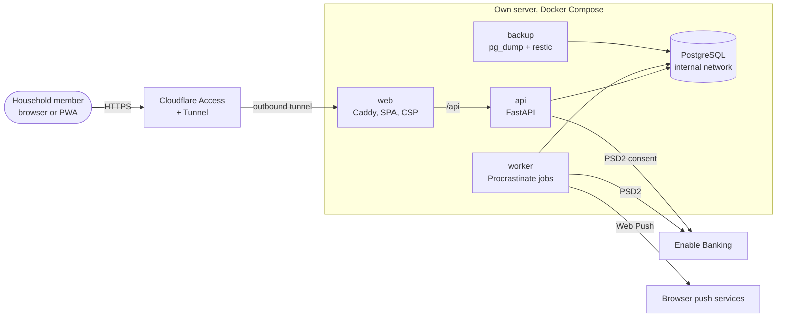
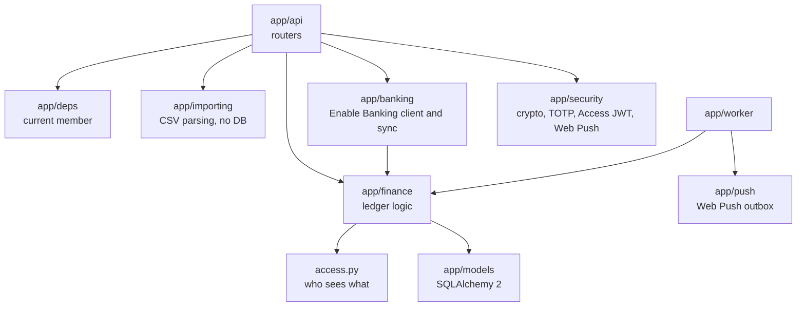

# Architecture: Orynthia Finance

Status: 25.11.2026. Decisions behind this structure: [docs/adr/](adr/). Deployment steps:
[deployment.md](deployment.md). Design tokens and contrast: [design.md](design.md).

## Context

One household with several members manages its money: accounts, bookings, contracts, budgets,
forecast and savings goals. The app runs on the household's own server and is reached only through
Cloudflare Tunnel behind Cloudflare Access.

## Containers

| Service | Role | Networks |
|---|---|---|
| `db` | PostgreSQL 18; data and the Procrastinate job queue | `internal` (no internet) |
| `api` | FastAPI: REST under `/api`, sessions, passkeys, CSV import, bank consent | `internal`, `edge` |
| `worker` | Procrastinate: periodic jobs and bank sync | `internal`, `edge` |
| `web` | Caddy: serves the React build, security headers, proxies `/api` | `edge` |
| `cloudflared` | outbound tunnel, no open port on the host | `edge` |
| `backup` | `pg_dump` plus restic to the configured repository | `internal`, `edge` |

Secrets come from Docker secrets (`/run/secrets`), settings from `FA_*` variables
(`backend/app/config.py`).

## Backend modules

- **One place for visibility:** `app/finance/access.py` decides which accounts, transactions,
  contracts and savings goals a member may see. Private accounts belong to their owner; hidden ids
  answer 404.
- **One pipeline for new bookings:** CSV import and bank sync both run dedupe hashing, category
  rules, transfer pairing and contract payment matching.
- **Money** is stored as integer cents (`bigint`), never as float.

## Background jobs (`app/worker.py`)

| Schedule | Job |
|---|---|
| hourly at :23 | sync bank connections whose last sync is older than 6 h |
| every 2 minutes | dispatch Web Push for new notifications (outbox `push_handled_at`) |
| daily 03:17 UTC | remove expired sessions and challenges |
| daily 03:30 Europe/Berlin | detect recurring payments as contract suggestions |
| daily 06:05 Europe/Berlin | create notifications: cancellation deadlines, price changes, budget warnings, expiring bank consent, failed syncs |

## Security

- Cloudflare Access in front; the API additionally verifies the `Cf-Access-Jwt-Assertion` header.
- Sign-in with a passkey, or an Argon2id password with optional TOTP; server-side sessions in the
  `fa_session` cookie (HttpOnly, SameSite=Strict).
- Sensitive values (TOTP secrets, bank sessions) encrypted with AES-256-GCM and context binding.
- Security-relevant actions write to `audit_log`; transaction contents are never logged.
- CI: ruff, strict mypy, pytest against a real Postgres, Biome, tsc, OpenAPI drift check, gitleaks,
  Trivy image scan.
